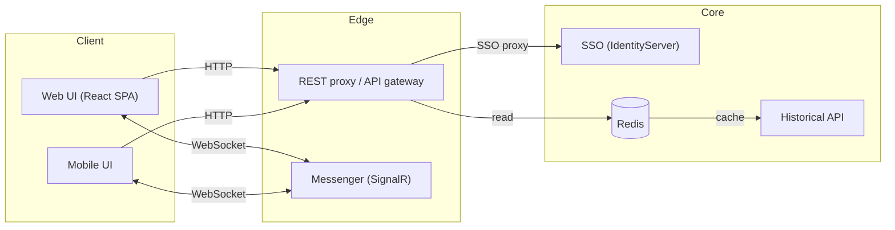
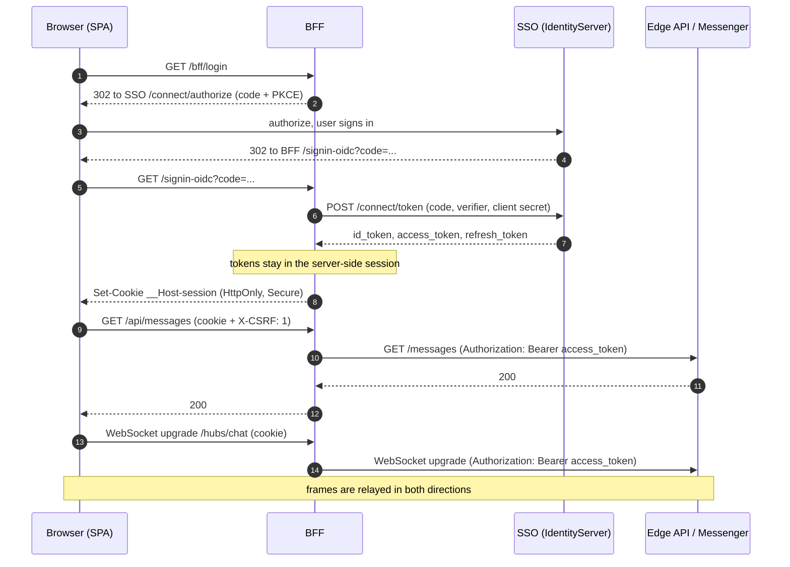
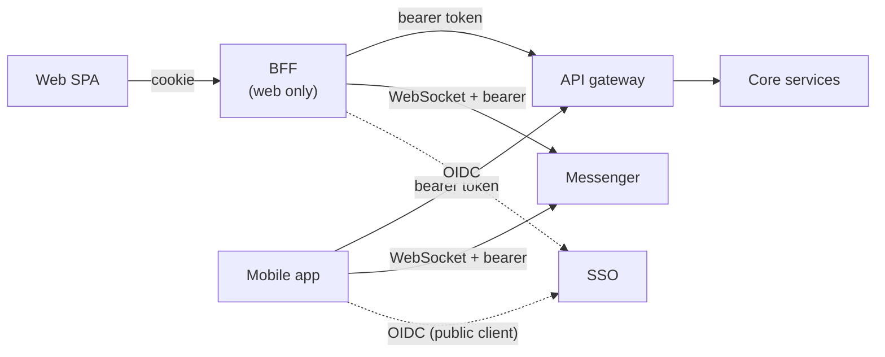
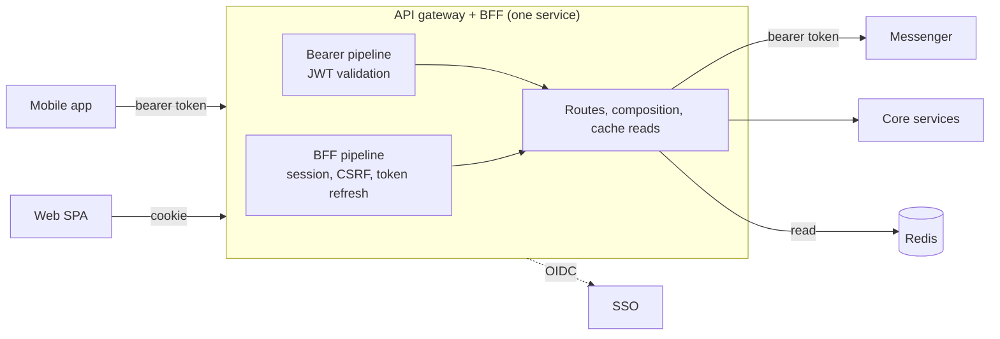
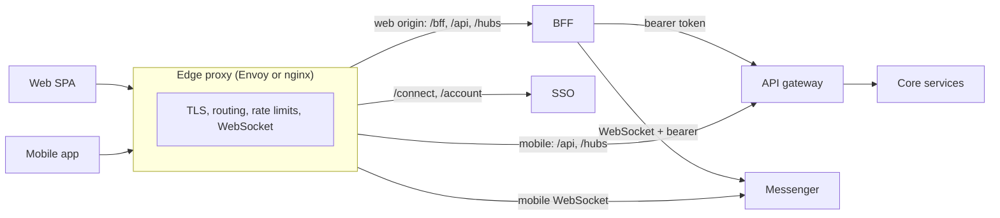

# 0003. Web client authentication via a Backend for Frontend (BFF)

- **Status:** Accepted
- **Date:** 2026-11-15
- **Superseded in part by:** [0005](0005-envoy-as-edge-proxy-and-api-gateway.md) (Proposed). Once 0005 is accepted, part 2 (topology: a separate API gateway behind a plain Envoy proxy) and the BFF proxy paths `/api/*` and `/hubs/*` in part 1 no longer apply. Envoy becomes the API gateway, and the BFF exposes `/bff/api/*` and `/bff/hubs/*`. The BFF pattern (part 1) and the Node.js choice (part 3) stay.

## Context

The web UI (`src/clients/web/chatty-duck-web`) is a React SPA served by Vite. It has to sign users in against the SSO (Duende IdentityServer) and then call Edge services on their behalf: HTTP APIs, and the Messenger's SignalR hub over WebSocket.

The SPA itself is static JavaScript running in the browser, so there are two broad ways to handle this:

1. **The browser holds tokens.** The SPA is a *public* OAuth client (authorization code + PKCE, no secret), keeps access and refresh tokens in JavaScript memory or storage, and sends them as `Authorization: Bearer` headers.
2. **A server holds tokens.** A small backend running on the same site as the SPA is the OAuth client. It is *confidential* (it has a client secret), keeps tokens server-side, and gives the browser only an `HttpOnly` session cookie. The SPA calls the backend, and the backend forwards the calls to the APIs with the access token attached. This is the **Backend for Frontend (BFF)** pattern.

Current guidance prefers the second option:

- The IETF draft *OAuth 2.0 for Browser-Based Applications* ranks the BFF as the most secure architecture, because any token reachable from JavaScript can be stolen by an XSS payload. Refresh tokens are the worst case, since they keep working after the user closes the tab.
- Duende recommends a BFF for every SPA that uses IdentityServer, and ships Duende.BFF for this purpose.
- Browsers keep tightening third-party cookies, which breaks the iframe-based silent renew that public SPA clients rely on.

Some constraints are specific to ChattyDuck:

- **.NET first, not .NET only.** The project is meant to show that its contracts (OIDC, HTTP, WebSocket) are technology-neutral. A component in a second language is a feature here, not a cost to avoid.
- **SignalR over WebSocket.** A browser cannot set an `Authorization` header on a WebSocket handshake. With a BFF, the browser opens the WebSocket to the BFF (same origin, so the cookie is sent), and the BFF forwards the upgrade request to Messenger with a bearer token attached.
- **Layering.** The BFF faces the browser, so it belongs in the **Edge** layer. It talks to the SSO (Core) over OIDC, and it may keep sessions in Redis (Core), which follows the existing Edge → Core rule. It must not reach Storage directly.
- **A REST proxy / API gateway is already planned** in the Edge layer (see `docs/system_overview_diagram.mmd`). It is meant to be the single HTTP entry point: it proxies the SSO and reads chat history through the Redis cache. A BFF is also an HTTP entry point and a proxy, so the two overlap and their relationship has to be decided.
- **Every hosted target already has a reverse proxy.** Kubernetes uses an ingress or Gateway API controller (ingress-nginx, Envoy Gateway and similar), Azure Container Apps has a built-in Envoy-based ingress, and Cloud Run sits behind Google's front end. So whatever we build, an infrastructure proxy will sit in front of it in the cloud. The question is what part it plays.
- The SSO was already prepared in an earlier change. `chatty-web-client` is confidential, with PKCE, rotating refresh tokens, and redirect URIs on `https://localhost:5002` for local development.

This planned architecture is the starting point for the options below:



## Decision

The decision has three parts: the pattern, the topology (including the edge proxy), and the BFF implementation language.

### 1. Pattern: a BFF

We will authenticate the web client through a **BFF** in the Edge layer that:

- is the only OIDC client for the web UI (`chatty-web-client`: confidential, authorization code + PKCE, `offline_access`);
- serves or fronts the SPA from the same site, so session cookies are first-party;
- keeps tokens server-side, in a session store that starts in memory and moves to Redis before running more than one instance. The browser gets one `__Host-` prefixed, `HttpOnly`, `Secure`, `SameSite=Lax` cookie;
- exposes `/bff/login`, `/bff/logout` and `/bff/user` endpoints for the SPA, plus the OIDC callback paths `/signin-oidc` and `/signout-callback-oidc`;
- proxies `/api/*` (HTTP) and `/hubs/*` (WebSocket) and attaches the user's access token. It refreshes the token when it is about to expire;
- protects proxied calls against CSRF by requiring a custom header (for example `X-CSRF: 1`) that a cross-site form post cannot set. This is the same technique Duende.BFF uses.

This is how a login, an API call and the SignalR connection work with a BFF, regardless of topology and language:



### 2. Topology: T3, with Envoy as the edge proxy

We will use **topology T3** (described under [Alternatives: topology](#topology-bff-vs-api-gateway-vs-edge-proxy)):

- **Envoy** is the single public entry point in the Edge layer. It routes by path to the BFF, the API gateway, Messenger and the SSO.
- **Envoy plays role 1, a plain reverse proxy.** It handles TLS termination, routing, WebSocket pass-through, rate limiting and request limits, and knows nothing about OIDC or users. It does not run `ext_authz` against the BFF (role 2) and does not use its OAuth2 filter (role 3). Either can be revisited in a new ADR if the BFF becomes a bottleneck.
- The **BFF** is a separate, thin Edge service used only by the web client. It does sessions, CSRF, token refresh and proxying to the gateway and Messenger with bearer tokens.
- The **API gateway** stays a separate Edge service that only accepts **bearer tokens**, for mobile clients and for the BFF.
- Where no Envoy runs, for example in the simplest inner loop, the same services work as T1. Envoy is added in front without changing them.

Envoy was chosen over nginx because:

- its WebSocket and HTTP/2 support needs no extra configuration;
- it has built-in OpenTelemetry tracing;
- it is what Envoy Gateway, Istio and Azure Container Apps ingress are built on, so local behaviour matches the Kubernetes and Azure targets more closely.

The price is more verbose configuration than nginx.

### 3. BFF implementation language: Node.js

We will write the BFF in **Node.js (TypeScript)**, using this stack:

| Concern | Choice | Why |
|---|---|---|
| OIDC client | [`openid-client`](https://github.com/panva/openid-client) v6 | OpenID Foundation certified, actively maintained, supports PKCE, refresh, DPoP and back-channel logout primitives |
| HTTP server | Express 5 (or Fastify) | Widely known, small, easy to explain |
| Sessions | `express-session` with a Redis store (`connect-redis`) | Same Redis the architecture already plans for |
| Proxy | `http-proxy-middleware` with `ws: true` | Handles both HTTP and the WebSocket upgrade that SignalR needs |

The options are compared under [Alternatives: implementation](#bff-implementation). T3 keeps this choice independent of the gateway's language. In T2, a Node BFF would also have meant a Node gateway.

Because we write security-critical code ourselves instead of using Duende.BFF, the BFF must:

- use `openid-client` for every protocol step, and never hand-roll the OIDC protocol;
- copy Duende.BFF's protections deliberately: the CSRF header, `__Host-` cookies, server-side token storage and per-session refresh locking;
- stay thin: authentication, sessions and proxying only, with no business logic.

## Alternatives considered

### Pattern

- **Public SPA client (tokens in the browser), for example `oidc-client-ts`.** This needs the least infrastructure: no extra service, and the SPA talks to IdentityServer directly. It is rejected because tokens are exposed to XSS, refresh tokens in the browser are a long-lived credential, silent renew keeps breaking under third-party cookie restrictions, and the WebSocket handshake would need the token in the query string, where it ends up in logs.
- **Token-mediating backend.** A backend runs the OIDC flow but hands the access token to the SPA. This is better than a public client because the refresh token stays server-side, but the access token is still reachable from JavaScript. It is rejected because it is about as much work as a full BFF and less secure.

### Topology: BFF vs API gateway vs edge proxy

These are three different jobs, and the topologies differ in which service does which:

| Job | What it does |
|---|---|
| **Edge proxy** (infrastructure) | TLS termination, host and path routing, WebSocket pass-through, rate limiting, request size limits, access logs. No knowledge of users. |
| **BFF** (application, web only) | OIDC client, browser sessions, CSRF, cookie-to-token translation, token refresh. |
| **API gateway** (application) | One HTTP API for *all* clients: routing to Edge and Core services, response composition, cache reads (Redis), the SSO proxy. Authenticates calls with **bearer tokens**. |

#### T1. Separate BFF next to the gateway

The web client talks only to the BFF, and mobile clients talk to the gateway. The BFF forwards to the gateway and Messenger with a bearer token.



- **Pros:** each service has one authentication model (cookies in the BFF, bearer tokens in the gateway). The BFF stays thin and its language choice is independent. Downstream services only ever see bearer tokens.
- **Cons:** the web path has an extra hop (BFF → gateway). There are two public entry points, each with its own TLS, routing and rate limiting, unless something sits in front of both (which is T3).

#### T2. BFF integrated into the gateway

One Edge service is the single entry point and runs two pipelines: cookie sessions for the web client and bearer tokens for mobile and machine clients.



- **Pros:** one service, one deployment and one hop. It matches the original idea of a single HTTP entry point. It is the shape Duende documents for **Duende.BFF + YARP**, where YARP is the gateway and Duende.BFF adds the session pipeline, so in .NET it is well trodden.
- **Cons:** the two authentication models are mixed in one process. A misconfigured route could accept a cookie where only a bearer token should be valid, so the CSRF rule has to apply exactly to the cookie-authenticated routes. The blast radius is larger, because a bug in gateway composition code now runs next to session handling. The gateway's language is forced to be the BFF's: a Node BFF means a Node gateway, which then also carries the Redis cache reads and the SSO proxy.

#### T3. Edge proxy in front, BFF and gateway behind *(chosen)*

An infrastructure proxy (Envoy, or nginx) is the only public entry point. It routes by path: `/bff/*`, `/signin-oidc`, `/api/*` and `/hubs/*` from the web origin go to the BFF; the mobile API host or path goes straight to the gateway; `/connect/*` and the login UI go to the SSO. Behind it, the BFF and the gateway are the same as in T1.



- **Pros:** cross-cutting edge concerns (TLS, rate limiting, WebSocket timeouts, header hygiene) live in one place built for them, and look the same in compose, Kubernetes and the cloud, where an Envoy- or nginx-based ingress is there anyway. Locally, everything can sit behind one origin (`https://localhost`), which removes CORS entirely. The BFF and gateway stay single-purpose.
- **Cons:** one more component to configure and run locally. Path-based routing rules become part of the contract and must stay in sync with the services. There is still an extra hop on the web path.

##### What Envoy or nginx could do beyond routing

There are three ways to involve the edge proxy more deeply, ordered from least to most responsibility:

1. **Plain reverse proxy (as in T3).** The proxy knows nothing about OIDC. This is the recommended role.

2. **Proxy data path, BFF as an authorization service.** The proxy still forwards the traffic itself, but before each request it asks the BFF to turn the cookie into a token: Envoy's `ext_authz` filter or nginx's `auth_request` module calls a small BFF endpoint, which validates the session, refreshes the token if needed and returns an `Authorization` header that the proxy adds to the upstream request. The BFF never carries request or WebSocket bodies; it only answers "who is this, and what token do they get".

   ```mermaid
   sequenceDiagram
       participant B as Browser
       participant P as Envoy / nginx
       participant BFF as BFF (auth service only)
       participant API as Gateway / Messenger
       B->>P: GET /api/messages (cookie, X-CSRF)
       P->>BFF: ext_authz / auth_request (cookie, X-CSRF)
       BFF-->>P: 200 + Authorization: Bearer access_token
       P->>API: GET /messages (Authorization: Bearer ...)
       API-->>P: 200
       P-->>B: 200
   ```

   - **Pros:** high-volume traffic and long-lived WebSockets go through a proxy built for them, and the BFF code gets smaller (no proxying).
   - **Cons:** every request costs an extra call to the BFF (cacheable briefly). The design is split across proxy config and code, which is harder to debug and to run in the inner loop. nginx's `auth_request` applies to the WebSocket handshake only, which is enough here.

3. **The proxy *is* the BFF.** Envoy's built-in OAuth2 filter (`envoy.filters.http.oauth2`), nginx Plus's OIDC module, or OpenResty with `lua-resty-openidc` run the code flow themselves. This is the off-the-shelf option D below. The main catch is that Envoy's OAuth2 filter keeps the tokens in (HttpOnly, HMAC-signed) cookies rather than in a server-side session, CSRF protection and a `/bff/user`-style endpoint are not provided, and refresh-token handling is limited. In practice you would still need custom code next to it.

**Envoy vs nginx for the edge proxy:** both do the T3 job well.
- *Envoy* has dynamic configuration, first-class HTTP/2, gRPC and WebSocket support, rich observability (OpenTelemetry tracing out of the box), and it is what Envoy Gateway, Istio and Azure Container Apps ingress are built on, so local and cloud behaviour match more closely. Its YAML is verbose.
- *nginx* is simpler to read and very common (ingress-nginx), but WebSocket proxying needs explicit `Upgrade`/`Connection` headers, and OIDC needs nginx Plus or OpenResty.

For a learning project that targets Kubernetes and Azure, **Envoy** is the better fit.

**Topology assessment:**
- **T3** was chosen because it separates the three jobs cleanly, mirrors what every hosted target does anyway, and keeps the BFF language decision independent of the gateway.
- **T1** is what T3 reduces to when no edge proxy runs, for example in the simplest inner loop. Building T3 therefore does not block running T1 locally.
- **T2** is the better choice *only* if the gateway and BFF are both .NET (Duende.BFF + YARP). In that case one well-documented service beats two.

### BFF implementation

| Option | Pros | Cons |
|---|---|---|
| **A. Node.js + `openid-client` + Express** *(chosen)* | Demonstrates the "not .NET only" principle with a real, security-relevant component. `openid-client` is certified and minimal. The TypeScript can share models with the React app. You learn exactly how a BFF works, because you write it. Fits T1 and T3 well. | You write and own security-critical glue yourself: CSRF, cookie flags, refresh locking, logout. Adds a second runtime to CI, containers, observability (OpenTelemetry for Node) and dependency updates. No Duende support. In T2 it would also force the gateway into Node. |
| **B. ASP.NET Core + Duende.BFF (+ YARP)** | Duende's own recommendation, built for exactly this. Anti-forgery, token refresh, server-side sessions, back-channel logout and the `/bff/*` endpoints come out of the box. Very little code. The natural choice for T2. | Another .NET service, so it does not exercise the technology-neutral contracts. Hides most of the mechanics you would learn by building it. Needs a Duende license for production (free for development; check whether Community Edition applies). |
| **C. ASP.NET Core + plain OIDC handler + YARP, without Duende.BFF** | No extra license. Uses only standard Microsoft libraries. | Reimplements what Duende.BFF provides, but in .NET, so it has the costs of A without its main benefit. |
| **D. Off-the-shelf auth proxy (oauth2-proxy, Envoy OAuth2 filter, nginx Plus or OpenResty OIDC)** | Configuration instead of code. Language-agnostic. Production-proven. | Weak fit for SPA needs: CSRF, `/bff/user`-style endpoints, server-side token storage and refresh control are limited or missing (see "the proxy *is* the BFF" above). Little to learn about OAuth itself. Debugging is harder. |
| **E. Go (or another compiled language) BFF** | Small static binary and container. Shows another runtime. | Smaller OIDC ecosystem than Node for this use. No code sharing with the React app. |

**Assessment.** **B** is the lowest-risk path and the one Duende recommends, and it pairs best with T2. **A** best serves the project's learning goal and its "not .NET only" principle, and pairs best with T1 or T3. A was chosen, under the conditions listed in [Decision, part 3](#3-bff-implementation-language-nodejs).

## Consequences

- **Security:** no tokens in the browser, CSRF handled by the custom-header rule, and one place to enforce session policy.
- **SignalR:** Messenger can stay a pure JWT-bearer API. The BFF (or, in the `ext_authz` variant, the edge proxy) converts the cookie into a bearer token on the WebSocket upgrade request.
- **Refresh token rotation needs care.** The SSO issues one-time refresh tokens, so two parallel requests that both try to refresh will race, and the loser gets `invalid_grant`. The BFF must serialise refreshes per session, with an in-process lock while there is one instance and a Redis lock when there are several.
- **Operations:** the BFF and Envoy are two more Edge components to deploy. Each needs a container image, a health check, compose wiring and later k8s and cloud wiring, as ADR 0002 requires. CI also needs a Node build job for the BFF, because the current workflow only builds the backend.
- **Envoy affects every service.** Behind it, services see Envoy's address and plain HTTP. Every ASP.NET service, the SSO first of all, needs forwarded-headers handling (trusting Envoy only), so that issuer URLs and redirects stay correct.
- **Envoy's routing table is part of the contract.** Path prefixes (`/bff`, `/signin-oidc`, `/api`, `/hubs`, `/connect`, `/account`) must stay in sync with the services. A route change is a change to Envoy's config, not just to a service.
- **In the cloud**, Envoy's role may be taken over by the platform ingress: Envoy Gateway on Kubernetes, or the built-in ingress of Azure Container Apps. The routing rules are what carries over, not necessarily the Envoy container.
- **The REST proxy / API gateway** becomes a bearer-token-only API. It no longer needs the "SSO proxy" role from the original diagram, because Envoy routes `/connect` and `/account` to the SSO directly.
- **Local development:** the BFF runs on `https://localhost:5002` and, in development, proxies Vite (`5173`) for the SPA, so the SPA, the API and the cookie all share one origin. In compose, Envoy takes over that role on one public origin, and the SSO's client redirect URIs and its public issuer URL then change to that origin.

### Follow-up work

- [ ] Create the BFF service folder under `src/edge/` and add it to the project-structure table in `.claude/CLAUDE.md`. The `ChattyDuck.<Layer>.<Component>` naming applies to .NET projects; a Node service needs its own convention, for example `src/edge/chatty-duck-bff`.
- [ ] Add Envoy configuration (for example `deploy/local/envoy/envoy.yaml`) and an Envoy service to `compose.yaml`.
- [ ] Add a Dockerfile, a health endpoint and a compose service for the BFF.
- [ ] Add a Node build job to CI.
- [ ] Add `AllowedCorsOrigins` to `chatty-web-client` only if the SPA ever calls IdentityServer directly. With a BFF it should not.
- [ ] Decide on back-channel logout, so that logging out of the SSO ends the BFF session too.
- [ ] Decide whether the mobile client uses the same Envoy origin or a separate API host.
