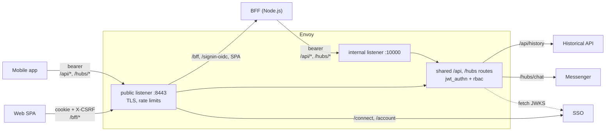

# 0005. Envoy as the edge proxy and API gateway

- **Status:** Proposed
- **Date:** 2026-11-16
- **Supersedes:** part 2 (topology) of [0003](0003-web-client-authentication-via-bff.md), and the BFF proxy paths in its part 1. The BFF pattern and the Node.js choice from 0003 stay.
- **Related:** [0004](0004-local-development-environment.md) (Envoy runs in every target, with shared routes and per-target clusters)

## Context

ADR 0003 chose topology **T3**: Envoy as the single public entry point, playing only the role of a plain reverse proxy that "knows nothing about OIDC or users", with a **separate API gateway service** behind it. That gateway was meant to:

- accept bearer tokens only, from mobile clients and from the BFF;
- route to Edge and Core services;
- compose responses and read from the Redis cache;
- proxy the SSO (a role 0003 already removed, because Envoy routes `/connect` and `/account` directly).

Looking at what is left of that list:

- **Routing** is already Envoy's job.
- **Bearer token validation** can be done by Envoy's `jwt_authn` filter, and **per-route scope checks** by its `rbac` filter, without custom code.
- **Rate limiting and request limits** are already Envoy's job.
- **Response composition** has no use case yet. Clients call per-resource APIs (history, messaging).
- **Redis cache reads** are a concern of the service that owns the data: the Historical API already sits behind the cache in the architecture diagram.

So the separate gateway would be a service that forwards requests, which Envoy already does. It would add a hop, a deployment, and a language decision, for almost no behaviour of its own.

Merging the two also changes a rule in `.claude/CLAUDE.md` ("no auth logic" in Envoy), which is why it needs this ADR.

## Decision

### 1. Envoy is the edge proxy *and* the API gateway

There is no separate REST proxy / API gateway service. Envoy is the single entry point for every client, and it:

| Envoy does | Envoy does not |
|---|---|
| TLS termination, path routing, WebSocket pass-through | Run login flows or hold sessions (the BFF does, ADR 0003) |
| Validate JWT access tokens: signature, issuer, expiry, audience | Compose responses or contain business logic |
| Enforce the required **scope per route** | Decide data-level permissions ("is this user in this conversation"); services do |
| Rate limits, request size limits, timeouts, access logs | Read from Redis or any store |
| Strip client-supplied `X-Forwarded-*` headers and set its own | |

### 2. Routes on one public origin

The public listener (`https://localhost:8443` locally, ADR 0004) routes by path:

| Path | Upstream | Token check in Envoy |
|---|---|---|
| `/` and SPA assets, `/bff/*`, `/signin-oidc`, `/signout-callback-oidc` | BFF | None. The BFF checks its session cookie and the CSRF header |
| `/connect/*`, `/.well-known/*`, `/account/*` and the SSO UI | SSO | None |
| `/api/*` | Edge and Core HTTP services, by sub-path (for example `/api/history` to the Historical API) | JWT required, scope per route |
| `/hubs/*` | Messenger (SignalR) | JWT required on the WebSocket upgrade |

- **Mobile and other bearer clients** call `/api/*` and `/hubs/*` directly with their access token.
- **The web SPA never calls `/api/*` directly.** It calls `/bff/api/*` and `/bff/hubs/*` with its cookie and the `X-CSRF` header. The BFF forwards them to Envoy's **internal listener** as `/api/*` and `/hubs/*`, with the user's access token attached. This replaces the BFF paths `/api/*` and `/hubs/*` from ADR 0003, which collided with the bearer-only routes on the same origin.
- **The internal listener** (port `10000`) is not published outside the Docker network or cluster. It uses the **same route configuration** as the public `/api/*` and `/hubs/*` routes, so web and mobile traffic pass exactly the same token and scope checks. It skips TLS and the public rate limits, which are meant for the outside world, not for the BFF.



### 3. Token validation with `jwt_authn`

- One provider, `sso`:
  - `issuer` is the SSO's **public** issuer URL, as it appears in tokens;
  - `audiences: [chatty-api]`, the API resource the SSO already issues;
  - the signing keys are fetched from the SSO's JWKS endpoint (`/.well-known/openid-configuration/jwks`) over the **internal** cluster address, then cached and refreshed in the background.
- Tokens are read from the `Authorization: Bearer` header. On `/hubs/*` only, they are also read from the `access_token` query parameter, because a browser or mobile SignalR client cannot set headers on a WebSocket handshake.
- The validated token is forwarded to the service (`forward: true`), and its claims are written to request metadata for the `rbac` filter (`payload_in_metadata`).
- Routes that need no token (SSO, BFF) disable the filter per route.
- A missing, expired or invalid token gets **401** from Envoy.
- If more API resources appear later, a route can require a different audience through `provider_and_audiences` in its requirement.

### 4. Scope checks with `rbac`

- Each `/api/*` and `/hubs/*` route carries an `RBACPerRoute` policy that allows the request only if the token's `scope` claim contains the scope that route needs. Today that is `chatty:read`; write scopes are added to the SSO and to the routes together.
- A valid token without the required scope gets **403** from Envoy.
- The `scope` claim must stay a **JSON array**. That is Duende's default; the SSO must not enable `EmitScopesAsSpaceDelimitedStringInJwt`, or every scope rule stops matching.

A route then looks like this (field names to be checked against the pinned Envoy version):

```yaml
- match: { prefix: "/api/history" }
  route: { cluster: historical-api }
  typed_per_filter_config:
    envoy.filters.http.jwt_authn:
      "@type": type.googleapis.com/envoy.extensions.filters.http.jwt_authn.v3.PerRouteConfig
      requirement_name: sso
    envoy.filters.http.rbac:
      "@type": type.googleapis.com/envoy.extensions.filters.http.rbac.v3.RBACPerRoute
      rbac:
        rules:
          action: ALLOW
          policies:
            read-history:
              permissions: [{ any: true }]
              principals:
              - metadata:
                  filter: envoy.filters.http.jwt_authn
                  path: [{ key: jwt_payload }, { key: scope }]
                  value: { list_match: { one_of: { string_match: { exact: "chatty:read" } } } }
```

### 5. Services still validate tokens

Envoy's checks are the outer layer, not the only one. Every service that receives a token still validates it (signature, issuer, audience) with its own JWT bearer handler, and makes data-level decisions itself. Reasons:

- traffic can reach a service without passing Envoy's rules (a misconfigured route, a future internal caller, a debugging session that calls a service port directly);
- scope says *what kind* of action is allowed; only the service knows *which data* the user may touch.

The two layers use the same rules: issuer, `aud = chatty-api`, and the scope names. Both come from the configuration contract (ADR 0004), not from code.

### 6. Limits that are accepted now

- **WebSockets are checked once.** The token is validated on the upgrade request only. An open SignalR connection is not closed when its token expires. Messenger can enforce a maximum connection lifetime if this matters later.
- **Tokens in query strings.** On `/hubs/*` the token may arrive as `?access_token=`. Envoy's access log format for those routes must not include the query string, and services must not log it either.
- **JWT access tokens only.** `jwt_authn` validates self-contained JWTs. Reference tokens or DPoP-bound tokens would need `ext_authz` (calling the SSO's introspection endpoint) or a custom filter. A new ADR is needed before turning either on in the SSO.
- **Rate limiting is local.** Envoy's `local_ratelimit` limits per Envoy instance. A global limit across several Envoy instances needs Envoy's rate limit service with Redis; that is a later decision.

### 7. Open point carried over: the SSO and the SPA share one origin

The SSO's login pages and static assets (`/account/*`, `/css/*`, `/lib/*`, …) live on the same origin as the SPA, whose catch-all route goes to the BFF. That works only if every SSO path is listed explicitly in Envoy and none collides with an SPA path. Two cleaner options are left for when the Envoy configuration is written:

- give the SSO a path base (for example `/sso`), so a single prefix route covers it; its issuer becomes `https://<origin>/sso`;
- give the SSO its own host name (for example `sso.chattyduck.localhost`), which needs a certificate for that name (mkcert, as `deploy/local/README.md` anticipates).

## Alternatives considered

- **Keep a separate API gateway service behind Envoy (ADR 0003's T3).** Clean separation of edge and application concerns, and a place for composition. Rejected for now: with no composition use case and cache reads belonging to the Historical API, the gateway would only forward requests. It can be reintroduced behind Envoy by a new ADR if composition is ever needed.
- **Envoy validates nothing; services do all token checks.** Simplest Envoy configuration. Rejected because it repeats coarse access rules in every service and lets invalid traffic reach them. Services still validate (Decision 5); Envoy adds an early, central check.
- **`ext_authz` to a custom authorisation service (or OPA) for every request.** Most flexible (any claim logic, introspection, DPoP), but adds a service and a call per request. Not needed while rules are "audience plus scope". Kept as the upgrade path.
- **A Lua or Wasm filter for scope checks.** Works with any claim format, but is code inside the proxy, harder to test and review. The built-in `rbac` filter covers the need.
- **The BFF calls services directly, bypassing Envoy.** One hop less for the web path, but then Envoy's scope rules would apply to mobile traffic only, and web traffic would depend entirely on the services' checks. Rejected so that every client passes the same rules.

## Consequences

- **One service fewer.** The planned REST proxy / API gateway is dropped from the Edge layer. The architecture diagram, the project-structure table in `.claude/CLAUDE.md` and ADR 0003 are updated.
- **Envoy's configuration is now security-critical.** A wrong route or a missing RBAC policy is an access-control bug. It needs:
  - validation in CI (`envoy --mode validate`);
  - an integration test that calls each protected route with no token, a token for another audience, a token without the scope and a good token, and checks for 401, 401, 403 and 200.
- **Access rules live in two places** (Envoy routes and service authorisation), on purpose. Scope names and the audience come from configuration so they cannot drift silently.
- **The BFF changes shape.** It exposes `/bff/api/*` and `/bff/hubs/*` instead of `/api/*` and `/hubs/*`, and forwards to Envoy's internal listener instead of to a gateway.
- **The Historical API owns its cache.** Redis reads move from the old gateway to the Historical API, which matches the existing "Redis caches Historical API" line in the diagram.
- **Kubernetes and cloud.** In Kubernetes, Envoy runs as a normal Deployment with the same configuration (ADR 0004). Envoy Gateway (Gateway API) offers JWT and claim-based authorisation through its `SecurityPolicy`, so the same rules could later move to it, but that is a separate decision.

### Follow-up work

- [ ] Write `deploy/shared/envoy/lds.yaml` with both listeners, the shared `/api` and `/hubs` routes, `jwt_authn` and `rbac`, as part of ADR 0004's spike.
- [ ] Decide the SSO origin question (Decision 7).
- [ ] Confirm that the SSO emits `scope` as a JSON array, and add the matching JWT bearer validation to Messenger.
- [ ] Add the Envoy route integration test and `envoy --mode validate` to CI.
- [ ] Update ADR 0003's follow-ups when the BFF is built: `/bff/api/*` and `/bff/hubs/*`, upstream is Envoy's internal listener.
